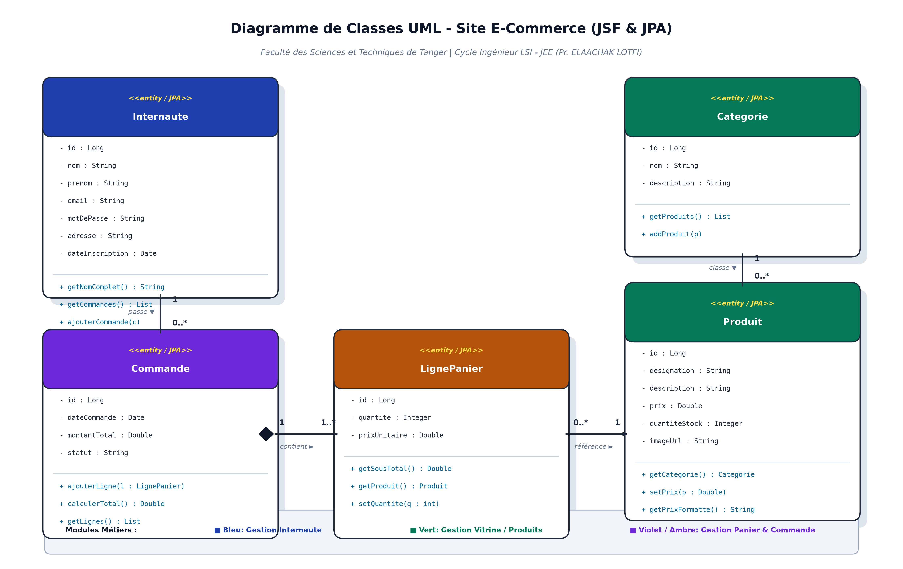
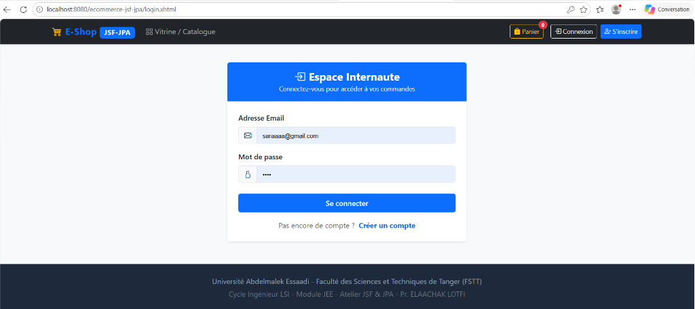
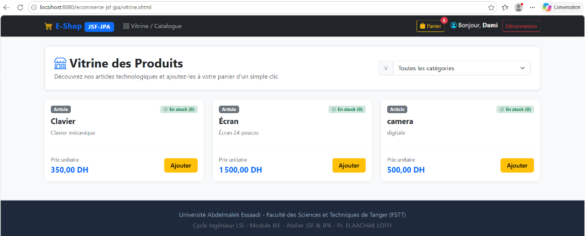
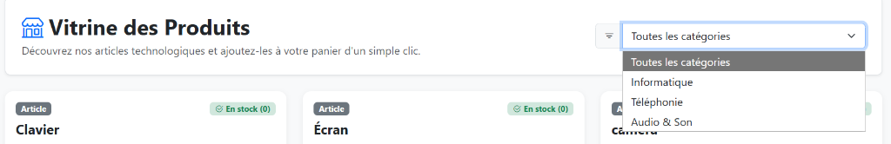
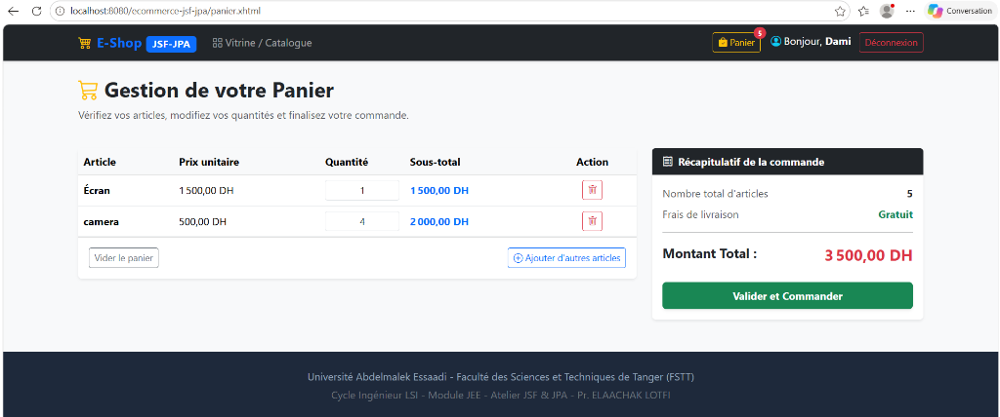
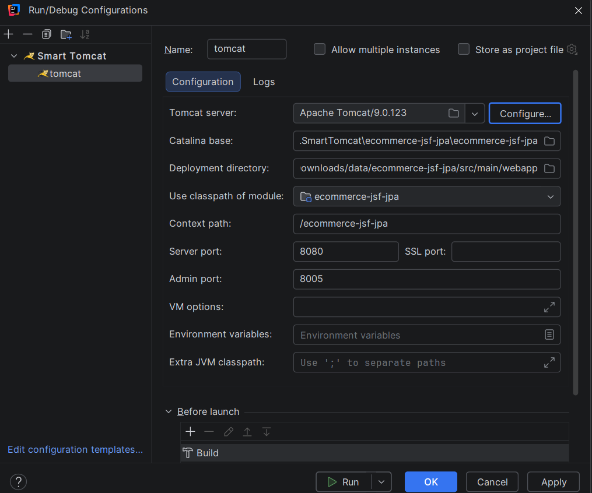

# 🛒 Application Web E-Commerce - JSF & JPA

[](https://www.oracle.com/java/)
[](https://javaserverfaces.github.io/)
[](https://www.eclipse.org/eclipselink/)
[](https://www.mysql.com/)
[](https://tomcat.apache.org/)
[](https://getbootstrap.com/)
[](https://maven.apache.org/)

---

## 🎓 Contexte Académique

* **Établissement :** Université Abdelmalek Essaadi (UAE) - Faculté des Sciences et Techniques de Tanger (FSTT)
* **Département :** Génie Informatique
* **Formation :** Cycle Ingénieur d'État en Génie Informatique (Filière LSI : Logiciels et Systèmes Intelligents)
* **Module :** JEE (Java Enterprise Edition)
* **Encadré par :** Pr. ELAACHAK LOTFI
* **Réalisé par :** **DAMI Sara**

---

## 📌 Présentation du Projet

Ce projet a pour objectif de concevoir et développer une **application web e-Commerce complète** en respectant les standards de l'architecture d'entreprise **Java EE / Jakarta EE**, articulée autour de la synergie entre :
1. **L'API JPA (Java Persistence API)** avec **EclipseLink** pour le mapping objet-relationnel (ORM) et la gestion transactionnelle ACID sur une base de données **MySQL**.
2. **Le Framework JSF (JavaServer Faces 2.2)** pour la couche de présentation et de contrôle web, reposant sur des **Managed Beans** à portées ciblées (`@SessionScoped`, `@ViewScoped`) et des vues réactives Facelets en XHTML.

L'application simule le comportement complet d'un site marchand autour de 3 piliers métiers :
* **👤 Gestion de l'Internaute :** Inscription, authentification sécurisée, maintien de session client et historique d'achats.
* **🛍️ Gestion de la Vitrine :** Catalogue dynamique des articles avec badges de stock, prix en Dirhams (DH) et filtrage asynchrone par catégorie via requêtes Ajax sans rechargement de page.
* **🛒 Gestion du Panier & des Commandes :** Panier en session HTTP, modification réactive des quantités, suppression, calcul automatique du total et validation finale avec persistance en base de données.

---

## 📐 Architecture et Diagramme de Classes UML

Le projet suit rigoureusement le modèle architectural **MVC 2 (Modèle - Vue - Contrôleur)** :
* **Modèle (M) :** Entités JPA annotées (`@Entity`), mapping ORM et couche DAO (`JPAUtil`, `EntityManagerFactory`, `EntityTransaction`).
* **Contrôleur (C) :** `FacesServlet` de JSF orchestrant les Managed Beans (`InternauteBean`, `VitrineBean`, `PanierBean`).
* **Vue (V) :** Gabarit moderne `layout.xhtml` et pages Facelets `.xhtml` stylisées avec **Bootstrap 5** et **Bootstrap Icons**.

```
                           +------------------------+
                           |  Client Web (Browser)  |
                           +------------------------+
                                       |
                                HTTP / Ajax
                                       ▼
                     +------------------------------------+
                     |  FacesServlet (Contrôleur Central) |
                     +------------------------------------+
                                       |
                 +---------------------+---------------------+
                 |                     |                     |
                 ▼                     ▼                     ▼
        +-----------------+   +-----------------+   +-----------------+
        | InternauteBean  |   |   VitrineBean   |   |   PanierBean    |
        | (@SessionScoped)|   |  (@ViewScoped)  |   | (@SessionScoped)|
        +-----------------+   +-----------------+   +-----------------+
                 |                     |                     |
                 +---------------------+---------------------+
                                       |
                                  Couche DAO
                                       |
                                       ▼
                       +-------------------------------+
                       |   JPA 2.0 (EclipseLink ORM)   |
                       |  EntityManager & Transactions |
                       +-------------------------------+
                                       |
                                   JDBC 8.0
                                       ▼
                       +-------------------------------+
                       |    Base de Données MySQL      |
                       |        (ecommerce_db)         |
                       +-------------------------------+
```

### Diagramme de Classes UML Métier



---

## 📸 Galerie des Captures d'Écran de l'Application

### 1. Espace Internaute (Connexion & Inscription)
Authentification de l'utilisateur avec validation des identifiants et création de session personnalisée.


### 2. Vitrine des Produits
Catalogue dynamique avec cartes produits, prix unitaire, état du stock et bouton d'ajout au panier.


### 3. Filtrage Dynamique par Catégories (Ajax)
Mise à jour en temps réel des produits affichés selon la catégorie sélectionnée (Informatique, Téléphonie, Audio).


### 4. Gestion du Panier & Validation de la Commande
Tableau récapitulatif avec ajustement des quantités, calcul automatique du sous-total et montant total cumulé (3 500,00 DH).


### 5. Configuration et Déploiement sous IntelliJ IDEA (Tomcat 9)
Configuration du serveur Apache Tomcat avec le plugin Smart Tomcat.


---

## 📂 Structure du Répertoire du Projet

```text
ecommerce-jsf-jpa/
├── database/
│   ├── init_db.sql                     # Script de création et données de test MySQL
│   └── uml_class_diagram.png           # Diagramme de classes UML généré
├── screenshots/                        # Captures d'écran de validation
│   ├── 01_login_internaute.png
│   ├── 02_vitrine_produits.png
│   ├── 03_vitrine_categories.png
│   ├── 04_panier_commande.png
│   ├── 05_intellij_config.png
│   └── uml_class_diagram.png
├── src/
│   └── main/
│       ├── java/
│       │   └── com/ecommerce/
│       │       ├── beans/              # Couche Contrôleur JSF (Managed Beans)
│       │       │   ├── InternauteBean.java   # @SessionScoped (Auth, Profil)
│       │       │   ├── PanierBean.java       # @SessionScoped (Panier, Commandes)
│       │       │   └── VitrineBean.java      # @ViewScoped (Catalogue, Filtres)
│       │       ├── dao/                # Couche Persistance & Transactions JPA
│       │       │   ├── CommandeDAO.java
│       │       │   ├── InternauteDAO.java
│       │       │   ├── JPAUtil.java          # Gestionnaire EntityManagerFactory
│       │       │   └── ProduitDAO.java
│       │       └── model/              # Couche Modèle (Entités JPA)
│       │           ├── Categorie.java
│       │           ├── Commande.java
│       │           ├── Internaute.java
│       │           ├── LignePanier.java
│       │           └── Produit.java
│       ├── resources/
│       │   └── META-INF/
│       │       └── persistence.xml     # Unité de persistance JPA & EclipseLink DDL
│       └── webapp/                     # Couche Présentation Facelets (Vues XHTML)
│           ├── WEB-INF/
│           │   ├── faces-config.xml    # Configuration JSF
│           │   └── web.xml             # Descripteur de déploiement Servlet
│           ├── template/
│           │   └── layout.xhtml        # Gabarit général commun (Navbar, Footer)
│           ├── confirmation.xhtml      # Confirmation de commande
│           ├── inscription.xhtml       # Inscription nouvel internaute
│           ├── login.xhtml             # Page d'authentification
│           ├── panier.xhtml            # Panier d'achats interactif
│           └── vitrine.xhtml           # Page d'accueil / Catalogue des produits
├── pom.xml                             # Dépendances Maven (MySQL, JPA, JSF, Mojarra)
├── Rapport_Atelier_JSF_JPA_Ecommerce_Final.docx # Rapport officiel Word complet
└── README.md                           # Documentation du projet GitHub
```

---

## ⚙️ Prérequis & Installation

### Prérequis Système
* **JDK :** Java SE 8 ou Java 17+ (Temurin / OpenJDK / Oracle)
* **IDE :** IntelliJ IDEA (Community ou Ultimate) ou Eclipse IDE for Enterprise Java
* **SGBD :** MySQL 8.0 (ou MariaDB via WampServer, XAMPP ou service autonome)
* **Serveur Web :** Apache Tomcat 9.0.x

---

## 🚀 Guide de Démarrage Rapide

### 1. Préparation de la Base de Données MySQL
Démarrez votre service MySQL et créez la base :
```sql
CREATE DATABASE IF NOT EXISTS ecommerce_db DEFAULT CHARACTER SET utf8mb4;
```
*(Les tables et clés étrangères sont automatiquement créées par EclipseLink au premier démarrage grâce à `eclipselink.ddl-generation = create-or-extend-tables`).*

### 2. Cloner le Projet
```bash
git clone https://github.com/votre-compte/ecommerce-jsf-jpa.git
cd ecommerce-jsf-jpa
```

### 3. Configuration dans IntelliJ IDEA
1. Ouvrez IntelliJ IDEA $\rightarrow$ **File > Open...** $\rightarrow$ Sélectionnez le dossier `ecommerce-jsf-jpa`.
2. Cliquez sur **Trust Project** puis **Open as Project**.
3. Allez dans **Run > Edit Configurations...** $\rightarrow$ Ajoutez une configuration **Smart Tomcat** :
   * **Tomcat Server :** Votre chemin vers Apache Tomcat 9.
   * **Deployment directory :** `src/main/webapp`
   * **Context path :** `/ecommerce-jsf-jpa`
   * **Server port :** `8080`
   * *(Optionnel si Java 17+)* Dans **VM options** :
     ```text
     --add-opens java.base/java.lang=ALL-UNNAMED --add-opens java.base/java.lang.reflect=ALL-UNNAMED --add-opens java.base/java.util=ALL-UNNAMED
     ```
4. Cliquez sur **Apply** puis **Run ▶️**.

### 4. Accès à l'Application
Ouvrez votre navigateur web sur :
👉 **`http://localhost:8080/ecommerce-jsf-jpa/vitrine.xhtml`**

---

## 📄 Rapport Technique Word

Le rapport académique complet conforme à la structure de l'énoncé du TP est disponible à la racine du projet :
* 📄 **Fichier Word (.docx) :** [`Rapport_Atelier_JSF_JPA_Ecommerce_Final.docx`](Rapport_Atelier_JSF_JPA_Ecommerce_Final.docx)
* Il comprend la page de garde officielle (FST Tanger, LSI, DAMI Sara, Pr. ELAACHAK LOTFI), les 4 étapes détaillées, le diagramme UML, l'explication des requêtes JPA/JSF et les captures d'écran intégrées.

---

## 👩‍💻 Auteure

* **DAMI Sara**
* Élève Ingénieure en Génie Informatique (Filière LSI)
* **Faculté des Sciences et Techniques de Tanger (FSTT)**
* Université Abdelmalek Essaadi
